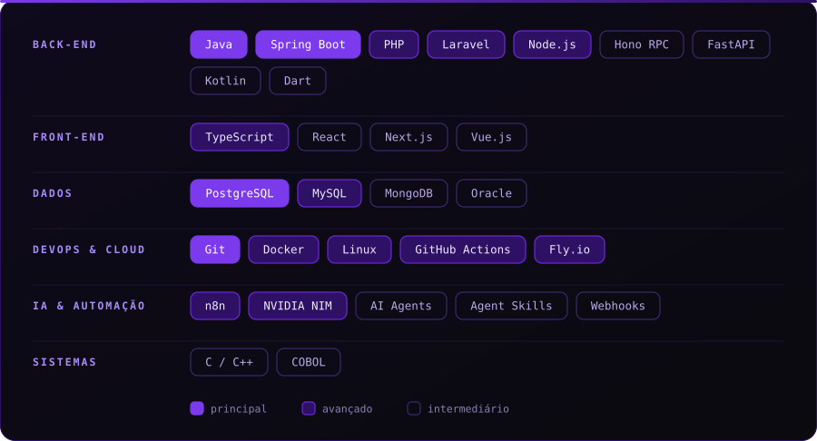
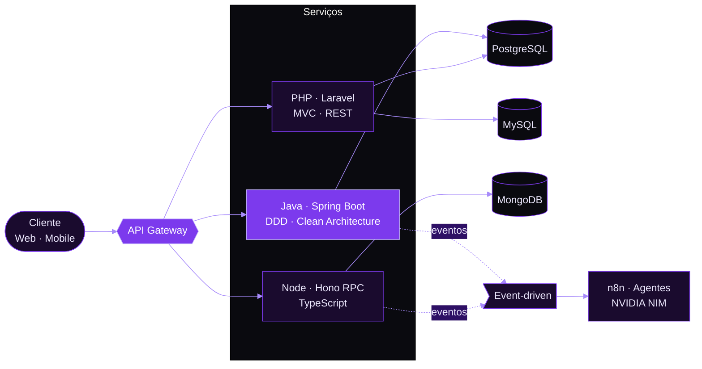

 

 

> Transformo problema de negócio em sistema que funciona em produção, aguenta crescimento e custa o que deveria custar.

Meu trabalho fica no ponto onde **tecnologia, produto e operação se encontram**: decidir o que construir, como construir e o que **não** construir. Escrevo código, desenho arquitetura e respondo pelo resultado até o deploy.

Hoje construo na **[StackBlackzada](https://github.com/StackBlackzada)**, um estúdio de tecnologia focado em software sob medida e **IA aplicada a processos de negócio**.

<table>
  <tr>
    <td width="33%" valign="top">

**Produto & Estratégia** 
Escopo enxuto, MVP que valida de verdade e roadmap guiado por impacto, não por moda.

</td>
    <td width="33%" valign="top">

**Arquitetura & Engenharia** 
Backend, APIs, microsserviços e dados. Decisões que o time consegue manter daqui a 2 anos.

</td>
    <td width="33%" valign="top">

**Qualidade & Entrega** 
CI/CD como gate, testes que protegem o negócio e deploy sem drama.

</td>
  </tr>
</table>

 

## Como eu trabalho

| Princípio | Na prática |
|:--|:--|
| **Resultado antes de tecnologia** | A stack serve ao problema. Se uma solução simples resolve, ela vence a elegante. |
| **Decisão registrada** | Arquitetura sem justificativa vira dívida. Toda escolha relevante tem o "porquê". |
| **Entrega contínua** | Pequenos incrementos em produção valem mais que um grande lançamento. |
| **Qualidade é automática** | Se depende de disciplina individual, não é processo. Pipeline barra o que não passa. |
| **Segurança desde o desenho** | Auth, autorização e hardening entram no começo, não no fim. |

 

## Stack

 

## Arquitetura

 

## Do commit ao deploy

 

## Projetos

Cada projeto parte de um problema real, com a decisão arquitetural que o sustenta.

| Projeto | Problema que resolve | Decisão-chave | Status |
|:--------|:---------------------|:--------------|:------:|
| **[Investment Aggregator](https://github.com/CaioSouzx00/investment-aggregator)** | Consolidar investimentos em uma visão única e confiável | Java · Spring Boot · PostgreSQL com DDD e Clean Architecture, para o domínio evoluir sem reescrever |  |
| **[Hydrax](https://github.com/CaioSouzx00/hydrax)** | Fluxo transacional com comunicação por e-mail | Laravel · PostgreSQL, MVC + REST pela velocidade de entrega com manutenção simples |  |
| **Automação n8n + NVIDIA NIM** | Atendimento e mensagens sem fila humana | Orquestração event-driven com LLM via API, rodando no Fly.io |  |
| **Backend Moderno** | Contrato de API sem divergência entre front e back | Hono RPC · TypeScript, tipagem ponta a ponta e pronto para edge |  |
| **Réplica Spotify** | Exercício de arquitetura de interface | React, componentização e SPA |  |

 

## Em estudo

`Rust` sistemas seguros e concorrência · `FHE` computação sobre dados cifrados · `NVIDIA NIM` agentes com tool calling e skills · `Hardening` OWASP, Auth/AuthZ e segurança de APIs

 

## GitHub

 

 

## Contato

Tem um problema que software pode resolver? Vamos conversar.

Técnico em Informática · ETEC &nbsp;·&nbsp; Goiás, BR

