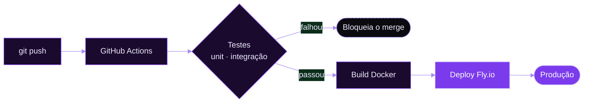
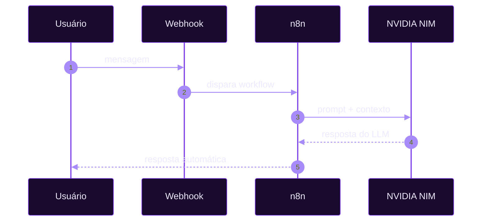
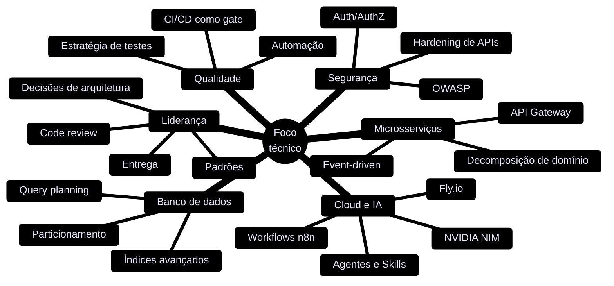

<div align="center">


<br/>


</div>

<br/>


<table>
  <tr>
    <td width="25%" valign="top">

**Software Developer**<br/>
<sub>APIs e sistemas backend em Java/Spring Boot, PHP/Laravel e Node/TypeScript.</sub>

</td>
    <td width="25%" valign="top">

**CTO**<br/>
<sub>Decisões técnicas, direção de arquitetura, escolha de stack e entrega do produto.</sub>

</td>
    <td width="25%" valign="top">

**Software Architect**<br/>
<sub>Microsserviços, DDD, Clean Architecture, event-driven e escalabilidade.</sub>

</td>
    <td width="25%" valign="top">

**QA**<br/>
<sub>Estratégia de testes, automação e qualidade de ponta a ponta.</sub>

</td>
  </tr>
</table>

<br/>


<div align="center">

</div>

<table>
  <tr>
    <td width="50%" valign="top">
      <br/>
      
      
      
      
      
      
      
      
      
    </td>
    <td width="50%" valign="top">
      <br/>
      
      
      
      
      
      
      
    </td>
  </tr>
  <tr>
    <td width="50%" valign="top">
      <br/>
      
      
      
      
      
      
      
      
    </td>
    <td width="50%" valign="top">
      <br/>
      
      
      
      
      
      
      
    </td>
  </tr>
</table>

<br/>


### Como eu desenho um sistema


### Do commit ao deploy



### Automação com IA



<br/>


<div align="center">


<br/>


<br/>


</div>

<br/>


| Projeto | Stack | Arquitetura | Status |
|:--------|:------|:------------|:------:|
| **[Hydrax](https://github.com/CaioSouzx00/hydrax)** | Laravel · PHP · PostgreSQL | MVC · REST · Transactional Email |  |
| **[Investment Aggregator](https://github.com/CaioSouzx00/investment-aggregator)** | Java · Spring Boot · PostgreSQL | DDD · Clean Architecture |  |
| **Backend Moderno** | Hono RPC · Node.js · TypeScript | Type-safe RPC · Edge-ready |  |
| **n8n + NVIDIA NIM Automation** | n8n · NVIDIA NIM API · Fly.io | Event-driven · Automação de mensagens |  |
| **Replica Spotify** | React.js · JavaScript | SPA · Component-driven |  |

<br/>




<br/>


```bash
$ ls ~/studying
rust/    fhe/    nvidia-nim/    hardening/

$ cat ~/studying/README
rust        →  sistemas seguros, concorrência e performance
fhe         →  computação sobre dados cifrados (criptografia homomórfica)
nvidia-nim  →  agentes de IA com tool calling e skills reutilizáveis
hardening   →  OWASP · Auth/AuthZ · segurança de APIs
```

<br/>


<div align="center">

[](https://github.com/CaioSouzx00)
[](https://www.linkedin.com/in/SEU-USUARIO)
[](mailto:seu@email.com)

</div>


<div align="center">
<sub>Técnico em Informática · ETEC &nbsp;·&nbsp; Goiás, BR</sub>
</div>