<div align="center">




<br/><br/>

<!-- Papéis -->
<p>
  
  
  
  
</p>

<!-- Tecnologias -->
<p>
  
  
  
  
  
  
  
  
</p>
<p>
  
  
  
  
  
  
  
  
</p>

<br/>


</div>


## ❯ Perfil

<table>
  <tr>
    <td width="25%" valign="top">

**Software Developer**<br/>
<sub>APIs e sistemas backend em Java/Spring Boot, PHP/Laravel e Node/TypeScript.</sub>

</td>
    <td width="25%" valign="top">

**CTO**<br/>
<sub>Decisões técnicas, direção de arquitetura, escolha de stack e entrega do produto.</sub>

</td>
    <td width="25%" valign="top">

**Software Architect**<br/>
<sub>Microsserviços, DDD, Clean Architecture, event-driven e escalabilidade.</sub>

</td>
    <td width="25%" valign="top">

**QA**<br/>
<sub>Estratégia de testes, automação e qualidade de ponta a ponta.</sub>

</td>
  </tr>
</table>


## ❯ Stack Completa

<table>
  <tr>
    <th width="25%"></th>
    <th width="25%"></th>
    <th width="25%"></th>
    <th width="25%"></th>
  </tr>
  <tr>
    <td align="center"></td>
    <td align="center"></td>
    <td align="center"></td>
    <td align="center"></td>
  </tr>
  <tr>
    <td align="center"></td>
    <td align="center"></td>
    <td align="center"></td>
    <td align="center"></td>
  </tr>
  <tr>
    <td align="center"></td>
    <td align="center"></td>
    <td align="center"></td>
    <td align="center"></td>
  </tr>
  <tr>
    <td align="center"></td>
    <td align="center"></td>
    <td align="center"></td>
    <td align="center"></td>
  </tr>
  <tr>
    <td align="center"></td>
    <td align="center"></td>
    <td align="center"></td>
    <td align="center"></td>
  </tr>
  <tr>
    <td align="center"></td>
    <td align="center"></td>
    <td align="center"></td>
    <td align="center"></td>
  </tr>
  <tr>
    <td align="center"></td>
    <td align="center"></td>
    <td align="center"></td>
    <td align="center"></td>
  </tr>
  <tr>
    <td align="center"></td>
    <td align="center">&nbsp;</td>
    <td align="center"></td>
    <td align="center">&nbsp;</td>
  </tr>
  <tr>
    <td align="center"></td>
    <td align="center">&nbsp;</td>
    <td align="center">&nbsp;</td>
    <td align="center">&nbsp;</td>
  </tr>
</table>


## ❯ Estatísticas GitHub

<div align="center">


</div>

<div align="center">


</div>

<div align="center">


</div>

<div align="center">


</div>


## ❯ Projetos

| Projeto | Stack | Arquitetura | Status |
|:--------|:------|:------------|:------:|
| **[Hydrax](https://github.com/CaioSouzx00/hydrax)** | Laravel · PHP · PostgreSQL | MVC · REST · Transactional Email |  |
| **[Investment Aggregator](https://github.com/CaioSouzx00/investment-aggregator)** | Java · Spring Boot · PostgreSQL | DDD · Clean Architecture |  |
| **Backend Moderno** | Hono RPC · Node.js · TypeScript | Type-safe RPC · Edge-ready |  |
| **n8n + NVIDIA NIM Automation** | n8n · NVIDIA NIM API · Fly.io | Event-driven · Automação de mensagens |  |
| **Replica Spotify** | React.js · JavaScript | SPA · Component-driven |  |


## ❯ Foco Técnico Atual

<table>
  <tr>
    <td width="50%" valign="top">


Decomposição de domínio · Event-driven · API Gateway

<br/><br/>


Índices avançados · Query planning · Particionamento

<br/><br/>


Estratégia de testes · Automação · CI/CD como gate de qualidade

</td>
    <td width="50%" valign="top">


OWASP · Auth/AuthZ · Hardening de APIs

<br/><br/>


Deploy em Fly.io · Workflows n8n · NVIDIA NIM · Agentes e Skills

<br/><br/>


Decisões de arquitetura · Padrões · Revisão de código · Entrega

</td>
  </tr>
</table>


## ❯ Em Estudo

```bash
$ ls ~/studying
rust/    fhe/    nvidia-nim/    hardening/

$ cat ~/studying/README
rust        →  sistemas seguros, concorrência e performance
fhe         →  computação sobre dados cifrados (criptografia homomórfica)
nvidia-nim  →  agentes de IA com tool calling e skills reutilizáveis
hardening   →  OWASP · Auth/AuthZ · segurança de APIs
```


## ❯ Contato

<div align="center">

[](https://github.com/CaioSouzx00)
[](https://linkedin.com/in/seu-perfil)
[](mailto:seu@email.com)

</div>

<br/>


<div align="center">
<sub>
  
  &nbsp;
  
</sub>
</div>